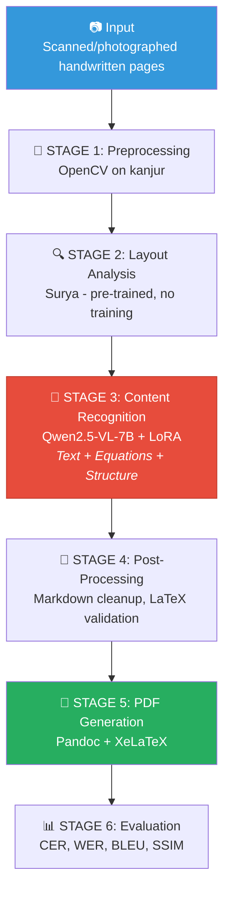

# Handwritten Lecture Notes → Digital PDF: Final Implementation Plan

> **Team:** 2 people (Person A + Person B) · **Timeline:** 4 weeks · **Compute:** IITB IEOR servers (CPU) + Kaggle (GPU) · **Domain:** Any handwritten notes · **Test Data:** IE643 Deep Learning notes

---

## 1. What We're Building

An end-to-end AI pipeline: **scanned handwritten notes → clean, searchable PDF**.

```
📷 Scan/Photo  →  🔧 Preprocess  →  🔍 Layout  →  🧠 Recognize  →  📐 Clean  →  📄 PDF
  (input)        (OpenCV)         (Surya)       (Qwen2.5-VL)     (post)      (Pandoc)
```

**One model does the heavy lifting:** Fine-tuned **Qwen2.5-VL-7B** handles text recognition, equation recognition, AND structure understanding in a single pass. No need for 3 separate models.

---

## 2. Compute Setup

### 2.1 IEOR Servers (CPU — for everything except training)

| Server | CPU | Cores | RAM | Use For |
|--------|-----|-------|-----|---------|
| **kanjur** | Xeon Gold 6530 @ 4.0GHz | 32 | **256 GB** | Preprocessing, CPU inference, PDF generation, Gradio app |
| **passpoli** | Threadripper PRO 5975WX | 32 | 128 GB | Backup / parallel work |

**How to connect:**
```bash
# On campus / VPN
ssh <ldap_id>@<kanjur_ip>

# Off campus (jump through gateway)
ssh -J <ldap_id>@login.ieor.iitb.ac.in <ldap_id>@<kanjur_ip>
```

### 2.2 Kaggle (GPU — for training only)

- **Free:** 2× NVIDIA T4 (16GB VRAM each), 30 hours/week
- Qwen2.5-VL-7B fits in 4-bit quantization (~5GB VRAM)
- Train on Kaggle → download LoRA adapter (~50–100MB) → deploy on kanjur for CPU inference

### 2.3 Where Each Task Runs

| Task | Runs On | Why |
|------|---------|-----|
| Image preprocessing | kanjur (CPU) | No GPU needed, fast on 32 cores |
| Layout detection (Surya) | kanjur (CPU) | Pre-trained, runs on CPU |
| **VLM fine-tuning** | **Kaggle (GPU)** | Needs CUDA for LoRA training |
| VLM inference (demo) | kanjur (CPU) | 4-bit quant, ~30-60s/page, 256GB RAM handles it |
| PDF generation (Pandoc) | kanjur (CPU) | No GPU needed |
| Gradio web app | kanjur | Host with `share=True` for public URL |
| Evaluation scripts | kanjur (CPU) | Pure Python computation |

> [!TIP]
> **Demo day speed trick:** If CPU inference on kanjur is too slow (~60s/page), keep a Kaggle notebook running with GPU and tunnel to it via `gradio.live` for real-time inference during the demo.

---

## 3. Pipeline Architecture



---

## 4. Stage-by-Stage Implementation

### STAGE 1: Preprocessing (OpenCV)

**Goal:** Clean raw scans for better model accuracy.

| Step | Technique | Code |
|------|-----------|------|
| 1 | Grayscale conversion | `cv2.cvtColor(img, cv2.COLOR_BGR2GRAY)` |
| 2 | Contrast enhancement (CLAHE) | `cv2.createCLAHE(clipLimit=2.0, tileGridSize=(8,8))` |
| 3 | Noise removal | `cv2.GaussianBlur(img, (5,5), 0)` + `cv2.medianBlur(img, 3)` |
| 4 | Binarization | `cv2.adaptiveThreshold(..., cv2.ADAPTIVE_THRESH_GAUSSIAN_C, ...)` |
| 5 | Skew correction | `cv2.minAreaRect` on contours → `cv2.warpAffine` to rotate |
| 6 | Border removal | Contour detection → crop to page boundary |
| 7 | Resolution normalization | Resize to 300 DPI equivalent |

```python
class NotesPreprocessor:
    def __init__(self, target_dpi=300):
        self.target_dpi = target_dpi

    def process(self, image_path: str) -> np.ndarray:
        img = cv2.imread(image_path)
        img = self._remove_borders(img)
        gray = cv2.cvtColor(img, cv2.COLOR_BGR2GRAY)
        gray = self._enhance_contrast(gray)       # CLAHE
        gray = self._remove_noise(gray)            # Gaussian + morphological
        gray = self._correct_skew(gray)            # minAreaRect rotation
        gray = self._normalize_resolution(gray)
        return gray
```

**Advanced options (if time permits):**
- Document dewarping using DocTr for curved/warped pages
- Deep learning binarization using SauvolaNet for degraded docs

---

### STAGE 2: Layout Analysis (Surya — pre-trained)

**Goal:** Detect regions — text blocks, equations, diagrams — and determine reading order.

**Why Surya (not YOLOv8):** Pre-trained, no training needed, works out of the box for document layout. Saves an entire week vs training YOLOv8.

```python
from surya.layout import LayoutPredictor

predictor = LayoutPredictor()

def detect_layout(image):
    results = predictor([image])
    regions = []
    for block in results[0].bboxes:
        regions.append({
            'bbox': block.bbox,           # [x1, y1, x2, y2]
            'label': block.label,          # 'Text', 'Figure', 'Table', etc.
            'confidence': block.confidence
        })
    # Sort by reading order: top-to-bottom, left-to-right
    regions.sort(key=lambda r: (r['bbox'][1], r['bbox'][0]))
    return regions
```

**Diagram handling:** Detect diagram regions → crop as images → embed directly in the final PDF. VLM generates a caption for each diagram as a bonus.

---

### STAGE 3: Content Recognition (Qwen2.5-VL-7B + LoRA)

**This is the core of the project.** One fine-tuned model handles everything.

#### What the model does:
- Reads handwritten text → outputs clean typed text
- Recognizes math equations → outputs LaTeX (`$$...$$`)
- Understands structure → outputs Markdown with headings (`#`, `##`), bullets (`-`), numbering (`1.`)

#### Fine-tuning setup (runs on Kaggle):

```python
from unsloth import FastVisionModel
from trl import SFTTrainer, SFTConfig

# Load in 4-bit (fits in T4 16GB VRAM)
model, tokenizer = FastVisionModel.from_pretrained(
    "unsloth/Qwen2.5-VL-7B-Instruct-bnb-4bit",
    load_in_4bit=True,
)

# Add LoRA adapters (only ~2% of params trained)
model = FastVisionModel.get_peft_model(
    model,
    r=16, lora_alpha=32,
    target_modules=["q_proj", "k_proj", "v_proj", "o_proj",
                     "gate_proj", "up_proj", "down_proj"],
    lora_dropout=0.05,
)

# Training config
training_args = SFTConfig(
    output_dir="./qwen_handnotes_lora",
    num_train_epochs=3,
    per_device_train_batch_size=1,
    gradient_accumulation_steps=4,
    learning_rate=2e-5,
    lr_scheduler_type="cosine",
    warmup_ratio=0.1,
    fp16=True,
    logging_steps=10,
    save_strategy="epoch",
    evaluation_strategy="epoch",
)

trainer = SFTTrainer(
    model=model, args=training_args,
    train_dataset=train_dataset,
    eval_dataset=val_dataset,
    tokenizer=tokenizer,
)
trainer.train()

# Save adapter (~50-100MB) → download → deploy to kanjur
model.save_pretrained("./qwen_handnotes_lora")
```

#### Training data format (JSONL):

```json
{
  "messages": [
    {
      "role": "user",
      "content": [
        {"type": "image", "image": "page_042.jpg"},
        {"type": "text", "text": "Convert this handwritten lecture note page to clean structured Markdown. Use LaTeX ($$...$$) for all math equations. Preserve headings (#, ##), bullet points, numbering, and logical structure."}
      ]
    },
    {
      "role": "assistant",
      "content": "# Backpropagation\n\n## Chain Rule\n\nThe gradient of the loss w.r.t. weight $w$:\n\n$$\\frac{\\partial L}{\\partial w} = \\frac{\\partial L}{\\partial y} \\cdot \\frac{\\partial y}{\\partial w}$$\n\n### Steps:\n1. Forward pass: compute activations layer by layer\n2. Compute loss at output layer\n3. Backward pass: propagate gradients using chain rule\n\n> **Key insight:** Each layer only needs the gradient from the layer above."
    }
  ]
}
```

#### Inference on kanjur (CPU):

```python
from transformers import Qwen2_5_VLForConditionalGeneration, AutoProcessor
from peft import PeftModel

# Load base + LoRA adapter (uses ~5GB RAM on CPU)
base_model = Qwen2_5_VLForConditionalGeneration.from_pretrained(
    "Qwen/Qwen2.5-VL-7B-Instruct",
    torch_dtype=torch.float32, device_map="cpu",
)
model = PeftModel.from_pretrained(base_model, "./models/qwen_lora_adapter")
processor = AutoProcessor.from_pretrained("Qwen/Qwen2.5-VL-7B-Instruct")

def recognize_page(image_path: str) -> str:
    """~30-60 seconds per page on kanjur CPU."""
    image = Image.open(image_path)
    messages = [{"role": "user", "content": [
        {"type": "image", "image": image},
        {"type": "text", "text": "Convert to structured Markdown with LaTeX equations."}
    ]}]
    inputs = processor(messages, return_tensors="pt")
    output = model.generate(**inputs, max_new_tokens=2048)
    return processor.decode(output[0], skip_special_tokens=True)
```

---

### STAGE 4: Post-Processing

**Goal:** Fix common VLM output errors before PDF generation.

```python
import re

def post_process(raw_markdown: str) -> str:
    md = raw_markdown
    
    # 1. Fix heading hierarchy (H1 should appear before H2, etc.)
    # 2. Merge paragraphs split across lines
    md = re.sub(r'(?<!\n)\n(?!\n)', ' ', md)  # single newlines → space
    
    # 3. Validate LaTeX: ensure matching $$ and $ delimiters
    # 4. Fix common OCR errors: 'l' ↔ '1', 'O' ↔ '0', etc.
    # 5. Normalize bullet points (*, -, •) to consistent '-'
    md = re.sub(r'^[•\*]\s', '- ', md, flags=re.MULTILINE)
    
    # 6. Remove artifacts / gibberish
    # 7. Basic spell-check (optional: pyspellchecker)
    
    return md
```

---

### STAGE 5: PDF Generation (Pandoc + XeLaTeX)

**Goal:** Convert structured Markdown → professional PDF with proper math rendering.

```python
import subprocess, tempfile, os

def generate_pdf(markdown: str, output_path: str, template_path: str = None):
    with tempfile.NamedTemporaryFile(mode='w', suffix='.md', delete=False) as f:
        f.write(markdown)
        md_path = f.name
    
    cmd = [
        'pandoc', md_path, '-o', output_path,
        '--pdf-engine=xelatex',
        '-V', 'geometry:margin=1in',
        '-V', 'fontsize=11pt',
        '--highlight-style=tango',
        '--number-sections',
    ]
    if template_path:
        cmd += [f'--template={template_path}']
    
    subprocess.run(cmd, check=True)
    os.unlink(md_path)
```

**Custom LaTeX template** features:
- Clean modern fonts
- Color-coded headings
- Styled equation blocks with numbering
- Header/footer with page numbers
- Theorem/definition/proof environments

---

### STAGE 6: Evaluation

| Metric | What It Measures | Target | Library |
|--------|-----------------|--------|---------|
| **CER** | Character-level accuracy | < 8% | `jiwer` |
| **WER** | Word-level accuracy | < 15% | `jiwer` |
| **BLEU-4** | N-gram overlap with ground truth | > 0.65 | `sacrebleu` |
| **ExpRate** | Equation exact match rate | > 50% | Custom |
| **SSIM** | Visual similarity (rendered output vs ideal) | > 0.75 | `skimage` |
| **Throughput** | Processing speed | > 1 pg/min | Timing |

```python
from jiwer import cer, wer
import sacrebleu

def evaluate(predicted: str, reference: str) -> dict:
    return {
        'CER': cer(reference, predicted),
        'WER': wer(reference, predicted),
        'BLEU': sacrebleu.corpus_bleu([predicted], [[reference]]).score,
    }
```

**Qualitative evaluation:** Side-by-side grid (original scan | recognized Markdown | output PDF) for 10+ diverse pages in the report.

---

## 5. Dataset Strategy

### 5.1 What You Need

| Dataset | Purpose | Size | Source |
|---------|---------|------|--------|
| **Your IE643 DL notes** | Primary training + testing | 100–200 pages | Scan yourself |
| **Other course notes** | Domain diversity (math, stats, CS) | 100+ pages | You + classmates |
| **IAM Handwriting Database** | Benchmark evaluation (optional TrOCR baseline) | 13K text lines | [HuggingFace](https://huggingface.co/datasets/Teklia/IAM-line) |
| **CROHME 2019** | Equation recognition evaluation | ~10K expressions | [Kaggle](https://www.kaggle.com/) |
| **HME100K** | Extra handwritten equation images | 100K images | Kaggle |

### 5.2 Custom Dataset Collection — YOUR IMMEDIATE NEXT STEP

> [!IMPORTANT]
> This is the **most critical early task**. Model quality is directly proportional to dataset quality. Start collecting and scanning NOW.

#### What to collect:

| Category | Target Pages | Content Type | Why |
|----------|-------------|--------------|-----|
| IE643 Deep Learning notes | 80–100 | Text + equations + diagrams | Primary domain |
| Math/Stats course notes | 50–70 | Heavy equations, proofs | Equation diversity |
| CS/General course notes | 30–50 | Text-heavy, code, pseudocode | Text diversity |
| Classmate's notes (different handwriting) | 30–50 | Mixed | Handwriting style diversity |
| **Total** | **200–250 pages** | | |

#### Scanning guidelines:

1. **Resolution:** 300 DPI minimum — use **CamScanner** / **Adobe Scan** / **Microsoft Lens** app (they auto-crop and enhance)
2. **Format:** JPEG or PNG (JPEG is fine for smaller files)
3. **Lighting:** Even lighting, no shadows across the page
4. **Naming convention:**
   ```
   ie643_page_001.jpg
   ie643_page_002.jpg
   math_page_001.jpg
   stats_page_001.jpg
   classmate_alice_page_001.jpg
   ```
5. **Include variety — pages with:**
   - ☐ Pure text paragraphs
   - ☐ Dense equations (derivations, proofs)
   - ☐ Mixed text + equations
   - ☐ Diagrams / figures / graphs
   - ☐ Bullet points and numbered lists
   - ☐ Tables
   - ☐ Different pen colors (black, blue)
   - ☐ Different paper types (lined, blank, grid)

#### Annotation strategy (bootstrap with AI, then manually verify):

```python
import google.generativeai as genai
import os

# Get a FREE API key from https://aistudio.google.com/apikey
genai.configure(api_key="YOUR_GEMINI_API_KEY")

def auto_transcribe(image_path: str) -> str:
    """Use Gemini to auto-generate ground truth. Review manually after."""
    model = genai.GenerativeModel("gemini-2.0-flash")
    img = genai.upload_file(image_path)
    response = model.generate_content([
        img,
        "Convert this handwritten lecture note page into clean, structured Markdown.\n"
        "Rules:\n"
        "- Use # for main headings, ## for subheadings, ### for sub-subheadings\n"
        "- Use LaTeX wrapped in $$ for display equations, $ for inline math\n"
        "- Use - for bullet points, 1. 2. 3. for numbered lists\n"
        "- Use > for important notes or definitions\n"
        "- Describe any diagrams in [Diagram: description] format\n"
        "- Preserve ALL content faithfully — do not summarize or skip anything\n"
    ])
    return response.text

# Batch process all scanned pages
raw_dir = "data/raw_scans/"
ann_dir = "data/annotations/"
os.makedirs(ann_dir, exist_ok=True)

for img_file in sorted(os.listdir(raw_dir)):
    if img_file.endswith(('.jpg', '.png')):
        print(f"Transcribing {img_file}...")
        md = auto_transcribe(os.path.join(raw_dir, img_file))
        out_name = img_file.rsplit('.', 1)[0] + '.md'
        with open(os.path.join(ann_dir, out_name), 'w') as f:
            f.write(md)
```

> [!WARNING]
> **AI transcriptions will have errors.** You MUST manually review and correct at least:
> - **All 30 test set pages** — 100% accuracy needed for reliable evaluation
> - **50+ training pages** — spot-check and fix major errors (wrong equations, missing content)
> - Focus on: equation LaTeX accuracy, heading levels, missed/hallucinated content

#### Creating JSONL training file:

```python
import json, os

def create_training_data(raw_dir, ann_dir, output_path):
    data = []
    for img_file in sorted(os.listdir(raw_dir)):
        if not img_file.endswith(('.jpg', '.png')):
            continue
        md_file = img_file.rsplit('.', 1)[0] + '.md'
        md_path = os.path.join(ann_dir, md_file)
        if not os.path.exists(md_path):
            continue
        with open(md_path, 'r') as f:
            ground_truth = f.read()
        sample = {
            "messages": [
                {"role": "user", "content": [
                    {"type": "image", "image": img_file},
                    {"type": "text", "text": "Convert this handwritten lecture note to structured Markdown with LaTeX equations."}
                ]},
                {"role": "assistant", "content": ground_truth}
            ]
        }
        data.append(sample)
    with open(output_path, 'w') as f:
        for s in data:
            f.write(json.dumps(s) + '\n')
    print(f"Created {len(data)} samples → {output_path}")
```

#### Dataset split:
```
Total: ~200 pages
├── Train:      150 pages (75%)
├── Validation:  20 pages (10%)
└── Test:        30 pages (15%) ← manually verified gold standard
```

---

## 6. Gradio Web Interface

```python
import gradio as gr

with gr.Blocks(theme=gr.themes.Soft(), title="HandNotes → PDF") as demo:
    gr.Markdown("# 📝 HandNotes → PDF Converter")
    gr.Markdown("Upload handwritten lecture notes → get a clean, formatted PDF")
    
    with gr.Row():
        with gr.Column(scale=1):
            input_images = gr.Files(label="📤 Upload Note Pages", file_types=["image"])
            with gr.Accordion("⚙️ Options", open=False):
                skew_correct = gr.Checkbox(label="Auto skew correction", value=True)
                enhance = gr.Checkbox(label="Contrast enhancement", value=True)
                gen_toc = gr.Checkbox(label="Table of contents", value=False)
            convert_btn = gr.Button("🚀 Convert to PDF", variant="primary", size="lg")
        
        with gr.Column(scale=2):
            with gr.Tabs():
                with gr.Tab("📄 Preview"):
                    markdown_out = gr.Markdown(label="Recognized Content")
                with gr.Tab("📊 Metrics"):
                    metrics_out = gr.JSON(label="Quality Metrics")
                with gr.Tab("🖼️ Comparison"):
                    gallery = gr.Gallery(label="Original vs Output")
            pdf_download = gr.File(label="📥 Download PDF")
    
    convert_btn.click(
        fn=process_pipeline,
        inputs=[input_images, skew_correct, enhance, gen_toc],
        outputs=[markdown_out, pdf_download, metrics_out, gallery]
    )

# Host on kanjur — share=True gives a public URL for demo day
demo.launch(server_name="0.0.0.0", server_port=7860, share=True)
```

---

## 7. Four-Week Schedule (Day-by-Day)

### Task Division

| Person | Primary Responsibility |
|--------|----------------------|
| **Person A (You)** | Preprocessing, VLM fine-tuning, recognition pipeline, integration |
| **Person B** | Data collection/annotation, PDF generation, Gradio UI, evaluation, report |

---

### WEEK 1: Data + Preprocessing (Days 1–7)

| Day | Person A | Person B |
|-----|----------|----------|
| 1 | Set up conda env on kanjur, GitHub repo, install deps | Scan 100+ pages IE643 DL notes (phone scanner app) |
| 2 | Build preprocessing pipeline (grayscale → CLAHE → denoise → deskew) | Scan 50+ pages from other courses (math, stats) |
| 3 | Test preprocessing on 20+ real scans, iterate | Collect 30+ pages from classmate (different handwriting) |
| 4 | Set up Kaggle notebook, test zero-shot Qwen2.5-VL on raw scans | Get Gemini API key, run auto-transcription on all ~200 pages |
| 5 | Integrate Surya layout detection, test on preprocessed images | Manually review + correct 30 test-set transcriptions (gold standard) |
| 6 | Help review annotations, fix preprocessing edge cases | Continue reviewing + correcting 50+ training transcriptions |
| 7 | Finalize preprocessing + layout pipeline | Create JSONL training file, define train/val/test splits |

✅ **Milestone:** 200+ scans, 200+ auto-transcriptions, 30 gold-standard test pages, working preprocessing.

---

### WEEK 2: Training + PDF (Days 8–14)

| Day | Person A | Person B |
|-----|----------|----------|
| 8 | Set up Kaggle fine-tuning notebook (Unsloth + LoRA) | Install Pandoc + TexLive on kanjur, test basic MD→PDF |
| 9 | Start Qwen2.5-VL LoRA training (epochs 1–2) | Design custom LaTeX template (fonts, colors, equations) |
| 10 | Continue training (epoch 3), monitor val loss | Build PDF generation: Markdown → Pandoc → XeLaTeX → PDF |
| 11 | Evaluate on val set — CER/WER. Adjust hyperparams if needed | Handle PDF edge cases: equations, embedded diagram images |
| 12 | If needed: retrain. If good: evaluate on test set | Test PDF on 10+ manually-created Markdown files |
| 13 | Download LoRA adapter → transfer to kanjur → test CPU inference | Build evaluation scripts (CER, WER, BLEU) |
| 14 | Verify: image → preprocess → recognize → markdown works | Start Gradio app skeleton |

✅ **Milestone:** Trained LoRA adapter, working CPU inference, working PDF generator, eval scripts ready.

---

### WEEK 3: Integration + Interface (Days 15–21)

| Day | Person A | Person B |
|-----|----------|----------|
| 15 | Build `pipeline.py` — full end-to-end orchestrator | Build full Gradio interface with all tabs |
| 16 | Connect pipeline to PDF generator | Add side-by-side view (original → Markdown → PDF) |
| 17 | Test full pipeline on 20 unseen pages, debug failures | Add metrics display in UI |
| 18 | Build post-processing (Markdown cleanup, LaTeX validation) | Run evaluation on full 30-page test set |
| 19 | Handle multi-page documents (merge, reading order) | Generate qualitative comparison images for report |
| 20 | Optimize: caching, error handling, edge cases | Mini user study (3–5 classmates rate output 1–5) |
| 21 | Integration testing — fix all remaining bugs | Draft report outline, start writing |

✅ **Milestone:** Complete pipeline + Gradio app, evaluation results, qualitative samples.

---

### WEEK 4: Polish + Submit (Days 22–28)

| Day | Both |
|-----|------|
| 22 | Final testing on diverse notes from different domains |
| 23 | Fix remaining bugs, improve error handling |
| 24 | Package models: LoRA adapter, configs, model cards |
| 25 | Write README with setup + usage instructions |
| 26 | Write project report (A: stages 1-3, B: stages 4-6 + eval) |
| 27 | Record demo video, prepare presentation |
| 28 | Final submission |

✅ **Milestone:** Everything submitted.

---

## 8. Environment Setup Commands

### On kanjur (Day 1):
```bash
ssh <ldap>@<kanjur_ip>
mkdir -p ~/Project643 && cd ~/Project643

conda create -n handnotes python=3.11 -y
conda activate handnotes

# Core ML
pip install torch torchvision --index-url https://download.pytorch.org/whl/cpu
pip install transformers accelerate peft bitsandbytes

# Image processing
pip install opencv-python-headless Pillow scikit-image

# Layout + OCR
pip install surya-ocr

# Evaluation
pip install jiwer nltk sacrebleu

# Interface
pip install gradio

# PDF generation
conda install -c conda-forge pandoc -y
conda install -c conda-forge texlive-core -y

# Annotation
pip install google-generativeai

# Verify
python -c "import torch, transformers, cv2, gradio; print('All good!')"
pandoc --version
```

### On Kaggle (training notebook first cell):
```python
!pip install -q unsloth transformers peft accelerate bitsandbytes
!pip install -q qwen-vl-utils jiwer trl

import torch
print(f"GPU: {torch.cuda.get_device_name(0)}")
print(f"VRAM: {torch.cuda.get_device_properties(0).total_mem / 1e9:.1f} GB")
```

---

## 9. Repository Structure

```
Project643/
├── README.md
├── requirements.txt
│
├── data/
│   ├── raw_scans/                     # Original scanned images (200+)
│   │   ├── ie643_page_001.jpg
│   │   ├── math_page_001.jpg
│   │   └── ...
│   ├── processed/                     # After preprocessing
│   ├── annotations/                   # Ground truth Markdown files
│   │   ├── ie643_page_001.md
│   │   └── ...
│   ├── train.jsonl                    # Training data for Qwen
│   ├── val.jsonl
│   ├── test.jsonl
│   └── splits.json
│
├── src/
│   ├── preprocess.py                  # OpenCV preprocessing pipeline
│   ├── layout.py                      # Surya layout detection wrapper
│   ├── recognize.py                   # Qwen2.5-VL inference
│   ├── postprocess.py                 # Markdown cleanup & LaTeX validation
│   ├── pdf_gen.py                     # Pandoc + XeLaTeX PDF generation
│   ├── evaluate.py                    # CER, WER, BLEU, SSIM metrics
│   └── pipeline.py                    # End-to-end orchestrator
│
├── notebooks/
│   ├── 01_data_exploration.ipynb
│   ├── 02_qwen_finetuning.ipynb       # Run on Kaggle
│   └── 03_evaluation.ipynb
│
├── app/
│   └── gradio_app.py                  # Web interface
│
├── models/
│   └── qwen_lora_adapter/             # Downloaded from Kaggle
│
├── templates/
│   └── lecture_notes.tex              # Custom LaTeX template
│
├── scripts/
│   ├── bootstrap_annotations.py       # Auto-transcribe with Gemini
│   └── create_training_data.py        # Build JSONL
│
└── reports/
    ├── project_report.pdf
    └── figures/
```

---

## 10. Scope Management

| Feature | Status | Notes |
|---------|--------|-------|
| ✅ OpenCV preprocessing | **Keep** | Essential, Days 1–3 |
| ✅ Surya layout detection | **Keep** | Pre-trained, zero training effort |
| ✅ Qwen2.5-VL LoRA fine-tuning | **Keep** | Core deliverable |
| ✅ Pandoc PDF generation | **Keep** | Essential output |
| ✅ Gradio interface | **Keep** | Required deliverable |
| ✅ CER/WER/BLEU evaluation | **Keep** | Required deliverable |
| ⚠️ TrOCR fine-tuning (baseline) | **Nice-to-have** | Only if Week 2 goes well — good for report comparison |
| ❌ YOLOv8 layout training | **Cut** | Surya handles this without training |
| ❌ LayoutLMv3 | **Cut** | Too complex for 4 weeks |
| ❌ Table structure recognition | **Cut** | Handle as regular text |
| ❌ Diagram-to-code | **Cut** | Just embed diagram images |

---

## 11. Risk Mitigation

| Risk | Plan B |
|------|--------|
| IEOR server has no GPU | ✅ Already handled — train on Kaggle, infer on CPU |
| CPU inference too slow for demo | Pre-convert test pages in advance; or tunnel to Kaggle GPU |
| Fine-tuning doesn't improve over zero-shot | Zero-shot Qwen2.5-VL is already strong — use prompt engineering |
| Pandoc/TexLive missing on kanjur | Install via conda (no root needed) |
| Not enough training data | Bootstrap 200+ annotations with Gemini API |
| LaTeX errors break PDF | Validate LaTeX before rendering; fallback: render as image |

---

## 12. Key Papers to Read

| Paper | Year | Why |
|-------|------|-----|
| Qwen2-VL: Enhancing Vision-Language Model's Perception | 2024 | Our main model's architecture |
| TrOCR: Transformer-based OCR with Pre-trained Models | 2021 | Encoder-decoder HTR fundamentals |
| Nougat: Neural Optical Understanding for Academic Documents | 2023 | Same concept: document → Markdown |
| TexTeller: Customizable Production-Level LaTeX OCR | 2024 | Equation recognition benchmark |
| DocLayNet: A Large Human-Annotated Dataset for Document Layout | 2022 | Layout analysis fundamentals |

---

## 13. Deliverables Checklist

| # | Deliverable | What to Submit |
|---|------------|----------------|
| 1 | **Trained models** | Qwen2.5-VL LoRA adapter (~100MB) + config files |
| 2 | **Code + docs** | GitHub repo with README, docstrings, requirements.txt |
| 3 | **Interface** | Gradio web app (upload notes → download PDF) |
| 4 | **Metrics** | CER, WER, BLEU, ExpRate — shown in UI + report |
| 5 | **Qualitative results** | Side-by-side comparison grid (10+ pages) |
| 6 | **Stage-wise report** | Methodology, experiments, dataset, interface docs |

---

## 14. Start Now — Immediate Action Items

> [!IMPORTANT]
> **What to do TODAY:**

### Person A (You):
1. ☐ SSH into kanjur, run env setup commands from Section 8
2. ☐ Create GitHub repo, push initial directory structure from Section 9
3. ☐ Start building `src/preprocess.py` — get grayscale + CLAHE + deskew working

### Person B:
1. ☐ Install **CamScanner** or **Adobe Scan** on phone
2. ☐ Start scanning IE643 Deep Learning notes — **aim for 100 pages in Day 1–2**
3. ☐ Get a free Gemini API key from [Google AI Studio](https://aistudio.google.com/apikey)
4. ☐ Scan notes from 1–2 other courses for domain diversity
