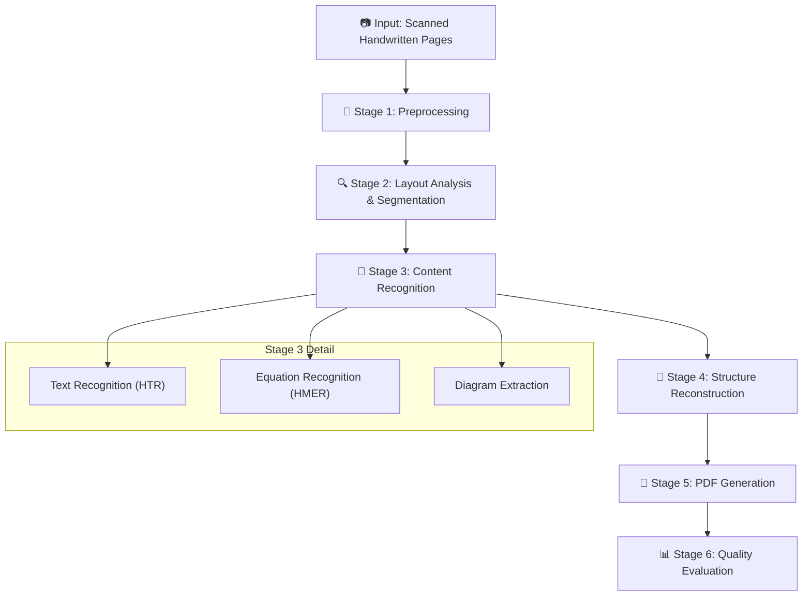
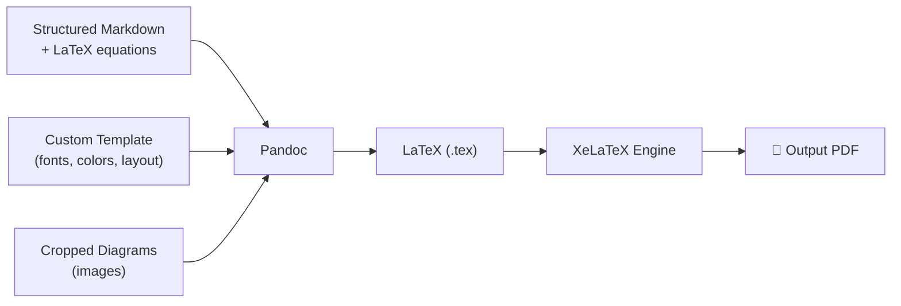
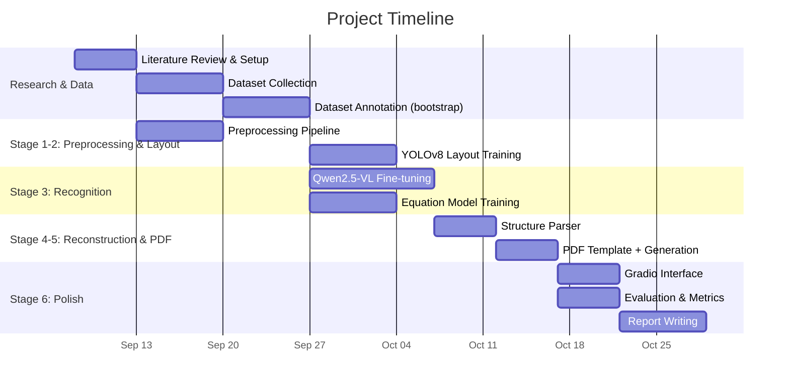

# Handwritten Lecture Notes → Digital PDF: Complete Project Roadmap

## 1. Project Overview & Problem Statement

**Goal:** Build an end-to-end AI pipeline that takes scanned/photographed handwritten lecture notes and produces clean, searchable, professionally formatted PDFs — preserving text, equations, diagrams, and structural hierarchy.

**Core Challenge:** Handwritten notes are inherently noisy, unstructured, and visually complex. Unlike printed documents, they feature irregular spacing, varied stroke widths, mixed content (text + math + diagrams), and no standardized layout.

---

## 2. System Architecture (High-Level)



---

## 3. Roadmap Options

We have **three possible roadmaps** depending on team size, GPU access, and timeline. I recommend starting with **Roadmap B** and enhancing with elements of **Roadmap C**.

### Roadmap A: API-First (Fastest, Least Custom ML)
| Aspect | Details |
|--------|---------|
| **Approach** | Use frontier VLM APIs (Gemini, GPT-4o, Claude) for recognition + custom preprocessing/PDF pipeline |
| **Pros** | Fast development, highest raw accuracy on messy handwriting |
| **Cons** | No model training/fine-tuning (may not satisfy deliverables), API costs, privacy concerns |
| **Timeline** | ~3–4 weeks |
| **Best For** | If the grading criteria don't emphasize custom model training |

### Roadmap B: Hybrid (Recommended — Best Balance) ⭐
| Aspect | Details |
|--------|---------|
| **Approach** | Fine-tune open-source VLM (Qwen2.5-VL-7B) for recognition + custom layout model (YOLOv8) + own PDF pipeline |
| **Pros** | Strong deliverables (fine-tuned models), good accuracy, fully self-hosted |
| **Cons** | Requires GPU access (Colab Pro / institutional GPU), medium complexity |
| **Timeline** | ~6–8 weeks |
| **Best For** | Maximum marks on all deliverables |

### Roadmap C: Full Custom Pipeline (Most Ambitious)
| Aspect | Details |
|--------|---------|
| **Approach** | Custom TrOCR fine-tuning + TexTeller for math + YOLOv8 layout + rule-based structure parser |
| **Pros** | Maximum learning, multiple trained models, deep understanding |
| **Cons** | Longest timeline, complex integration, potential failure points |
| **Timeline** | ~8–10 weeks |
| **Best For** | If you want to showcase deep ML expertise |

> [!IMPORTANT]
> **Recommendation:** Go with **Roadmap B** — fine-tuning Qwen2.5-VL gives you a single powerful model that handles text + equations + structure understanding, satisfying multiple deliverables at once. Supplement with a YOLOv8 layout detector for explicit structural analysis.

---

## 4. Detailed Stage-by-Stage Plan

---

### Stage 1: Handwritten Note Preprocessing

**Objective:** Transform raw scanned images into clean, normalized inputs for downstream models.

#### 4.1.1 Techniques to Implement

| Technique | Method | Library |
|-----------|--------|---------|
| **Grayscale Conversion** | Convert RGB → grayscale | OpenCV |
| **Noise Removal** | Gaussian blur, median filter, morphological opening | OpenCV |
| **Binarization** | Adaptive Gaussian thresholding (handles uneven lighting) | OpenCV |
| **Skew Correction** | Hough line transform or `minAreaRect` on contours | OpenCV |
| **Perspective Correction** | 4-point perspective transform for photographed (non-scanned) pages | OpenCV |
| **Contrast Enhancement** | CLAHE (Contrast Limited Adaptive Histogram Equalization) | OpenCV |
| **Resolution Normalization** | Resize/upscale to 300 DPI standard | Pillow/OpenCV |
| **Border Removal** | Detect and crop page boundaries | OpenCV contour detection |

#### 4.1.2 Implementation Plan

```python
# Preprocessing Pipeline Skeleton
class NotesPreprocessor:
    def __init__(self, target_dpi=300):
        self.target_dpi = target_dpi

    def process(self, image_path):
        img = cv2.imread(image_path)
        img = self.remove_borders(img)
        img = self.correct_perspective(img)
        img = self.convert_grayscale(img)
        img = self.enhance_contrast(img)       # CLAHE
        img = self.remove_noise(img)            # Gaussian + morphological
        img = self.binarize(img)                # Adaptive threshold
        img = self.correct_skew(img)            # Hough / minAreaRect
        img = self.normalize_resolution(img)
        return img
```

#### 4.1.3 Advanced Options
- **Document dewarping** using [DocTr](https://github.com/fh2019ustc/DocTr) for curved/warped pages
- **Deep learning-based binarization** using [SauvolaNet](https://github.com/Leedeng/SauvolaNet) for heavily degraded documents
- **Ink bleed-through removal** for double-sided scanned notes

---

### Stage 2: Layout Analysis & Page Segmentation

**Objective:** Detect and classify regions on each page — text blocks, equations, diagrams, headings, bullet points, tables, margins.

#### 4.2.1 Approach: Fine-Tune YOLOv8 for Layout Detection

**Why YOLOv8:**
- Real-time object detection optimized for document elements
- Lightweight, easy to train on custom data
- Excellent for bounding-box segmentation of document regions

**Classes to Detect:**
```
heading, subheading, paragraph, bullet_point, numbered_list,
equation_inline, equation_block, diagram, table, 
figure_caption, page_number, margin_note, underline
```

#### 4.2.2 Dataset for Layout Model

| Dataset | Description | Use |
|---------|-------------|-----|
| **PubLayNet** | 360K document images with layout annotations | Pre-train / transfer learn |
| **DocLayNet** | 80K pages from diverse document types | Fine-tune base |
| **Custom annotations** | 200–500 hand-annotated pages of YOUR lecture notes | Domain-specific fine-tuning |
| **Synthetic data** | Generate using LaTeX templates with controlled layout | Augment training set |

**Annotation Tool:** Use [Label Studio](https://labelstud.io/) or [Roboflow](https://roboflow.com/) to annotate your custom handwritten note pages.

#### 4.2.3 Alternative/Complementary Approaches

| Method | Description | When to Use |
|--------|-------------|-------------|
| **LayoutParser** | Pre-trained Detectron2 models for document layout | Quick baseline, no training needed |
| **DiT (Document Image Transformer)** | Microsoft's transformer for document understanding | If you want transformer-based approach |
| **Connected Component Analysis** | Classical CV — group connected pixel regions | Fast heuristic for simple layouts |
| **Contour-based segmentation** | Detect text blocks via contour hierarchy | Lightweight preprocessing step |

#### 4.2.4 Reading Order Detection
After detecting regions, determine the reading order:
- **XY-Cut algorithm**: Recursively split page into columns/rows
- **Graph-based ordering**: Build spatial graph of regions, topological sort
- **Rule-based**: Top-to-bottom, left-to-right with column detection

---

### Stage 3: Handwritten Content Recognition

This is the **core ML stage**. We need three recognition capabilities:

#### 4.3.1 Option A: Unified VLM Approach (Recommended ⭐)

**Model:** Fine-tune **Qwen2.5-VL-7B-Instruct** to handle all content types

**Why this is the best approach:**
- Single model handles text, equations, and structure simultaneously
- Pre-trained on massive document understanding data
- Outputs structured Markdown with LaTeX equations
- Reduces integration complexity (no separate models to orchestrate)

**Fine-tuning Strategy:**

```
Base Model: Qwen2.5-VL-7B-Instruct (from Hugging Face)
Method:     LoRA (r=16, alpha=32) via Unsloth or LLaMA-Factory
Dataset:    Custom JSONL with image → structured Markdown pairs
Hardware:   1x A100 (80GB) or 2x T4 (Colab Pro) with 4-bit quantization
Epochs:     3–5
LR:         2e-5 with cosine schedule
```

**Training Data Format (JSONL):**
```json
{
  "messages": [
    {
      "role": "user",
      "content": [
        {"type": "image", "image": "path/to/handwritten_page.jpg"},
        {"type": "text", "text": "Convert this handwritten lecture note page into clean, structured Markdown. Use LaTeX for equations (wrapped in $$). Preserve headings (#, ##), bullet points, numbering, and logical flow."}
      ]
    },
    {
      "role": "assistant",
      "content": "# Introduction to Linear Algebra\n\n## Vectors and Matrices\n\n- A **vector** is an ordered list of numbers\n- A **matrix** is a 2D array of numbers\n\n### Key Equation:\n\n$$Ax = b$$\n\nwhere $A$ is an $m \\times n$ matrix..."
    }
  ]
}
```

**How to Build the Fine-tuning Dataset:**
1. Collect 500–1000 handwritten note pages (your own notes, classmates', public datasets)
2. Manually transcribe 100–200 pages into structured Markdown (ground truth)
3. Use a frontier VLM (GPT-4o / Gemini) to auto-transcribe remaining pages
4. Manually review and correct the auto-transcriptions
5. Split: 80% train / 10% validation / 10% test

#### 4.3.2 Option B: Multi-Model Pipeline (More Complex, More Control)

If you want multiple fine-tuned models (better for deliverables variety):

##### B1: Text Recognition — Fine-tune TrOCR

```
Base:      microsoft/trocr-base-stage1
Dataset:   IAM Handwriting Database (line-level images)
Framework: HuggingFace Seq2SeqTrainer
Output:    Raw text per line
```

**Key Code:**
```python
from transformers import TrOCRProcessor, VisionEncoderDecoderModel

processor = TrOCRProcessor.from_pretrained("microsoft/trocr-base-stage1")
model = VisionEncoderDecoderModel.from_pretrained("microsoft/trocr-base-stage1")

# Fine-tune with Seq2SeqTrainer on IAM + custom data
```

##### B2: Equation Recognition — TexTeller or Surya

| Model | Parameters | Dataset | Output |
|-------|-----------|---------|--------|
| **TexTeller** | ~200M | Tex80M (built-in) | LaTeX string |
| **Surya (latex_ocr)** | ~100M | Pre-trained | LaTeX / Markdown |
| **Pix2Tex** | ~30M | im2latex-100K | LaTeX string |

**Recommended:** TexTeller for accuracy, Surya for ease of integration.

For fine-tuning on handwritten equations specifically:
```
Dataset: CROHME 2019 (online → offline conversion) + HME100K
Method:  Standard supervised fine-tuning
Metric:  Expression Recognition Rate (ExpRate) — % of exactly correct LaTeX
```

##### B3: Diagram Handling

Diagrams are the hardest to "recognize" since they can't be easily converted to text. Options:

| Approach | Description |
|----------|-------------|
| **Extract as image** | Detect diagram region → crop → embed as image in final PDF |
| **VLM description** | Use VLM to generate a text description/caption for the diagram |
| **Diagram-to-code** | Convert simple diagrams to Mermaid/TikZ (experimental, low reliability) |

> [!TIP]
> For a course project, **extracting diagrams as clean cropped images** and embedding them in the final PDF is the most reliable and practical approach. Add VLM-generated captions as a bonus.

---

### Stage 4: Structure & Layout Understanding

**Objective:** Convert raw recognized content into a structured document with proper hierarchy.

#### 4.4.1 Structure Classification

After recognition, classify each text block:

```python
class StructureClassifier:
    """
    Rules-based + ML classifier for document structure elements.
    """
    ELEMENT_TYPES = [
        'title', 'heading', 'subheading',
        'paragraph', 'bullet_point', 'numbered_list',
        'equation_block', 'equation_inline',
        'definition', 'theorem', 'proof',
        'table', 'diagram', 'caption',
        'page_header', 'page_footer'
    ]
```

#### 4.4.2 Approaches

| Method | Description | Accuracy | Effort |
|--------|-------------|----------|--------|
| **Rule-based heuristics** | Font size, position, indentation, bullet markers | Medium | Low |
| **BERT classifier** | Fine-tune BERT on text + spatial features | High | Medium |
| **VLM (unified)** | Qwen2.5-VL already outputs structured Markdown | High | Low (if using Option A) |
| **Layout-aware transformer** | LayoutLMv3 — combines text + layout + vision | Very High | High |

**If using Roadmap B (Qwen2.5-VL):** The VLM already handles structure understanding — it outputs Markdown with headings, lists, and equations naturally. Add a post-processing layer to fix common errors.

**If using Roadmap C (multi-model):** Train a **LayoutLMv3** model or build rule-based heuristics using the spatial features from the layout detector.

#### 4.4.3 Post-Processing Pipeline

```python
def post_process_structure(raw_markdown: str) -> str:
    """
    Clean and normalize the structured output.
    """
    # 1. Fix heading hierarchy (ensure H1 > H2 > H3)
    # 2. Merge split paragraphs
    # 3. Normalize bullet point styles
    # 4. Validate LaTeX syntax in equations
    # 5. Fix numbering sequences
    # 6. Remove OCR artifacts and gibberish
    # 7. Spell-check with context (domain-specific dictionary)
    return cleaned_markdown
```

---

### Stage 5: PDF Generation

**Objective:** Convert the structured Markdown + images into a clean, searchable, professional PDF.

#### 4.5.1 Recommended Approach: Pandoc + LaTeX (XeLaTeX)

**Why:** Best typographic quality, perfect LaTeX equation rendering, industry standard.



**Implementation:**
```python
import subprocess

def generate_pdf(markdown_content: str, output_path: str, template: str):
    """Generate PDF from structured Markdown using Pandoc + XeLaTeX."""
    md_path = "/tmp/notes.md"
    with open(md_path, 'w') as f:
        f.write(markdown_content)

    cmd = [
        'pandoc', md_path,
        '-o', output_path,
        '--pdf-engine=xelatex',
        f'--template={template}',
        '--highlight-style=tango',
        '-V', 'geometry:margin=1in',
        '-V', 'fontsize=11pt',
        '-V', 'mainfont=Inter',
        '--toc',                    # Table of contents
        '--number-sections',
    ]
    subprocess.run(cmd, check=True)
```

#### 4.5.2 Custom LaTeX Template

Create a professional template with:
- Modern fonts (Inter, Fira Code for monospace)
- Color-coded headings
- Styled equation blocks
- Clean header/footer with page numbers
- Syntax highlighting for code
- Custom theorem/definition environments

#### 4.5.3 Alternative PDF Approaches

| Method | Best For | Drawback |
|--------|----------|----------|
| **WeasyPrint** | HTML/CSS-styled reports | Math rendering requires MathJax pre-render |
| **ReportLab** | Programmatic layout control | Manual positioning, no Markdown support |
| **FPDF2** | Simple documents | No LaTeX math support |
| **Typst** | Modern alternative to LaTeX | Newer ecosystem, fewer templates |

---

### Stage 6: Quality Evaluation

**Objective:** Quantitatively and qualitatively measure system performance.

#### 4.6.1 Quantitative Metrics

| Metric | What It Measures | Target | Library |
|--------|-----------------|--------|---------|
| **CER** (Character Error Rate) | Character-level transcription accuracy | < 5% | `jiwer` |
| **WER** (Word Error Rate) | Word-level transcription accuracy | < 10% | `jiwer` |
| **BLEU** | N-gram overlap with reference | > 0.7 | `nltk` / `sacrebleu` |
| **ExpRate** | Exact match rate for equations | > 60% | Custom |
| **Layout IoU** | Bounding box overlap for detected regions | > 0.75 | `torchmetrics` |
| **SSIM** | Visual similarity of output PDF vs ideal | > 0.8 | `skimage` |
| **F1 (Structure)** | Structure element classification accuracy | > 0.85 | `sklearn` |

#### 4.6.2 Evaluation Protocol

```python
def evaluate_pipeline(test_set):
    results = {
        'cer': [], 'wer': [], 'bleu': [],
        'layout_iou': [], 'exp_rate': []
    }

    for sample in test_set:
        predicted = pipeline.process(sample.image)
        
        # Text accuracy
        results['cer'].append(compute_cer(predicted.text, sample.ground_truth_text))
        results['wer'].append(compute_wer(predicted.text, sample.ground_truth_text))
        results['bleu'].append(compute_bleu(predicted.text, sample.ground_truth_text))
        
        # Equation accuracy
        results['exp_rate'].append(
            exact_match(predicted.equations, sample.ground_truth_equations)
        )
        
        # Layout accuracy
        results['layout_iou'].append(
            compute_iou(predicted.boxes, sample.ground_truth_boxes)
        )
    
    return {k: np.mean(v) for k, v in results.items()}
```

#### 4.6.3 Qualitative Evaluation
- **Side-by-side comparison**: Original handwritten page vs. generated PDF
- **User study**: Have 5–10 people rate readability, accuracy, and formatting (1–5 scale)
- **Failure case analysis**: Document and categorize common errors

---

## 5. Datasets

### 5.1 Primary Datasets

| Dataset | Content | Size | Source | Use |
|---------|---------|------|--------|-----|
| **IAM Handwriting** | English handwritten text (lines, words) | 13K lines, 115K words | [FKI](https://fki.tic.heia-fr.ch/databases/iam-handwriting-database) | Train/evaluate HTR |
| **CROHME 2019** | Handwritten math expressions (InkML) | ~10K expressions | [TC-11](https://tc11.cvc.uab.es/datasets/) / Kaggle | Train/evaluate HMER |
| **HME100K** | Handwritten math expressions (images) | 100K images | Kaggle / Paper | Augment HMER training |
| **MathWriting** | Handwritten math (online) | Large-scale | Arxiv / Zenodo | Additional HMER data |
| **PubLayNet** | Document layout annotations | 360K images | [GitHub](https://github.com/ibm-aur-nlp/PubLayNet) | Pre-train layout model |
| **DocLayNet** | Diverse document layouts | 80K pages | IBM / HuggingFace | Fine-tune layout model |

### 5.2 Custom Dataset (CRITICAL)

> [!WARNING]
> Public datasets alone will **NOT** be sufficient. You **must** create a custom dataset of 200+ handwritten lecture note pages for domain-specific fine-tuning and evaluation. This is what differentiates a good project.

**How to build your custom dataset:**

1. **Collect** 300–500 pages of handwritten lecture notes:
   - Your own notes from various courses
   - Classmates' notes (with permission)
   - Photographed and scanned at 300 DPI minimum
   - Variety: different handwriting styles, pen colors, paper types

2. **Annotate** at multiple levels:
   - **Page-level**: Full structured Markdown transcription
   - **Region-level**: Bounding boxes + class labels (for layout model)
   - **Line-level**: Individual text line images + transcriptions (for TrOCR)

3. **Bootstrap annotations** using a frontier VLM:
   ```python
   # Use GPT-4o or Gemini to auto-generate initial transcriptions
   # Then manually verify and correct — 10x faster than manual annotation
   ```

4. **Split**: 70% train / 15% validation / 15% test

---

## 6. Tech Stack

### 6.1 Core Dependencies

```
# ML / Deep Learning
torch>=2.1
transformers>=4.40
peft                    # LoRA fine-tuning
accelerate              # Multi-GPU / mixed precision
bitsandbytes            # 4-bit quantization
unsloth                 # Fast fine-tuning for VLMs
ultralytics             # YOLOv8

# Image Processing
opencv-python>=4.8
Pillow>=10.0
scikit-image

# OCR / Document
surya-ocr               # Layout + OCR
pytesseract              # Baseline OCR comparison

# NLP / Text Processing
jiwer                    # CER/WER computation
nltk                     # BLEU score

# PDF Generation
# (System: pandoc, texlive-xetex)
weasyprint               # Alternative PDF engine
markdown                 # Markdown parsing
latex2mathml             # LaTeX rendering fallback

# Interface
gradio>=4.0              # Web UI
streamlit                # Alternative UI

# Evaluation
scikit-learn
torchmetrics
sacrebleu
```

### 6.2 Hardware Requirements

| Stage | Minimum | Recommended |
|-------|---------|-------------|
| **Preprocessing** | Any CPU | Any CPU |
| **Layout Training** | T4 (16GB) | A100 (40GB) |
| **VLM Fine-tuning** | 2x T4 (16GB) with 4-bit quant | A100 (80GB) |
| **TrOCR Fine-tuning** | T4 (16GB) | V100 (32GB) |
| **Inference** | T4 (16GB) | Any modern GPU |
| **PDF Generation** | Any CPU | Any CPU |

> [!TIP]
> **Free GPU options:** Google Colab (T4 free, A100 on Pro), Kaggle Notebooks (2x T4), your institution's HPC cluster.

---

## 7. Web Interface (Deliverable #2)

Build a **Gradio** web app with the following features:

### 7.1 Interface Design

```
┌─────────────────────────────────────────────┐
│  📝 HandNotes → PDF Converter               │
├─────────────────────────────────────────────┤
│                                             │
│  ┌─── Upload ───────────────────────────┐   │
│  │  📤 Upload scanned note pages        │   │
│  │     (Drag & drop multiple images)    │   │
│  │     [Browse Files]                   │   │
│  └──────────────────────────────────────┘   │
│                                             │
│  ⚙️ Options:                                │
│  ☑ Auto-correct skew    ☑ Enhance contrast  │
│  ☑ Detect equations     ☑ Generate TOC      │
│  [Font: Inter ▾]  [Margin: Normal ▾]        │
│                                             │
│  [🚀 Convert to PDF]                        │
│                                             │
├─────────────── Results ─────────────────────┤
│                                             │
│  ┌──────────┐  ┌──────────┐  ┌──────────┐  │
│  │ Original │  │ Markdown │  │  Output   │  │
│  │  Image   │  │  Preview │  │   PDF     │  │
│  │  (input) │  │  (parsed)│  │ (download)│  │
│  └──────────┘  └──────────┘  └──────────┘  │
│                                             │
│  📊 Metrics:                                │
│  Confidence: 94% | Regions: 12 | Pages: 3   │
│                                             │
└─────────────────────────────────────────────┘
```

### 7.2 Implementation

```python
import gradio as gr

def process_notes(images, options):
    """Main pipeline function."""
    results = []
    for img in images:
        preprocessed = preprocessor.process(img)
        layout = layout_detector.detect(preprocessed)
        content = recognizer.recognize(preprocessed, layout)
        structured = structure_parser.parse(content)
        results.append(structured)
    
    markdown = merge_pages(results)
    pdf_path = pdf_generator.generate(markdown)
    metrics = evaluator.compute_metrics(markdown)
    
    return markdown, pdf_path, metrics

demo = gr.Interface(
    fn=process_notes,
    inputs=[
        gr.Files(label="Upload Handwritten Notes", file_types=["image"]),
        gr.CheckboxGroup(["Skew Correction", "Contrast Enhancement", 
                         "Equation Detection", "TOC Generation"])
    ],
    outputs=[
        gr.Markdown(label="Recognized Content"),
        gr.File(label="Download PDF"),
        gr.JSON(label="Quality Metrics")
    ],
    title="📝 HandNotes → PDF Converter"
)
demo.launch()
```

---

## 8. Project Timeline (8-Week Plan)



---

## 9. Week-by-Week Action Plan

### Week 1: Setup & Research
- [ ] Set up Python environment (venv, dependencies)
- [ ] Literature review — read 5 key papers (TrOCR, TexTeller, LayoutLMv3, Qwen2.5-VL, DocLayNet)
- [ ] Set up GPU access (Colab Pro / institutional cluster)
- [ ] Download IAM, CROHME, PubLayNet datasets
- [ ] Build basic project structure and GitHub repo

### Week 2: Data Collection & Preprocessing
- [ ] Collect 300+ handwritten note pages (scan/photograph)
- [ ] Build the preprocessing pipeline (OpenCV)
- [ ] Test preprocessing on real samples — iterate
- [ ] Start bootstrapping annotations using GPT-4o/Gemini API
- [ ] Set up Label Studio for layout annotation

### Week 3: Layout Analysis
- [ ] Annotate 200+ pages with bounding boxes (layout regions)
- [ ] Train YOLOv8 layout detector on PubLayNet → fine-tune on custom data
- [ ] Evaluate layout detection (mAP, IoU)
- [ ] Implement reading order algorithm

### Week 4: Recognition Model Fine-tuning
- [ ] Prepare JSONL dataset for Qwen2.5-VL fine-tuning
- [ ] Fine-tune Qwen2.5-VL-7B with LoRA (3–5 epochs)
- [ ] Evaluate on validation set (CER, WER, BLEU)
- [ ] (Optional) Fine-tune TrOCR on IAM + custom data as baseline comparison

### Week 5: Equation Recognition + Integration
- [ ] Set up TexTeller / Surya for equation recognition
- [ ] Fine-tune on CROHME + HME100K if needed
- [ ] Integrate layout detector → recognizer → structured output
- [ ] Build the end-to-end pipeline

### Week 6: PDF Generation & Structure
- [ ] Design custom LaTeX template
- [ ] Build Pandoc-based PDF generation pipeline
- [ ] Handle edge cases: multi-column layouts, diagrams, tables
- [ ] Test on diverse input samples

### Week 7: Interface & Evaluation
- [ ] Build Gradio web interface
- [ ] Implement all evaluation metrics
- [ ] Run full evaluation on test set
- [ ] Generate qualitative comparison samples
- [ ] Conduct mini user study (5–10 people)

### Week 8: Report & Polish
- [ ] Write comprehensive stage-wise report
- [ ] Document all code with README and docstrings
- [ ] Package models for submission
- [ ] Record demo video
- [ ] Final testing and bug fixes

---

## 10. Key Papers to Read

| Paper | Year | Relevance |
|-------|------|-----------|
| TrOCR: Transformer-based OCR with Pre-trained Models | 2021 | Baseline HTR architecture |
| Qwen2-VL: Enhancing Vision-Language Model's Perception | 2024 | Fine-tuning target model |
| TexTeller: Customizable Production-Level LaTeX OCR | 2024 | Equation recognition |
| DocLayNet: A Large Human-Annotated Dataset for Document Layout Segmentation | 2022 | Layout understanding |
| LayoutLMv3: Pre-training for Document AI | 2022 | Structure understanding |
| YOLOv8 for Document Layout Analysis | 2023+ | Layout detection |
| Nougat: Neural Optical Understanding for Academic Documents | 2023 | End-to-end document → Markdown |

---

## 11. Repository Structure

```
Project643/
├── README.md                       # Project overview, setup, usage
├── requirements.txt                # Python dependencies
├── setup.py                        # Package setup
│
├── data/
│   ├── raw/                        # Raw scanned images
│   ├── processed/                  # Preprocessed images
│   ├── annotations/                # Layout annotations (COCO format)
│   ├── train/                      # Training splits
│   ├── val/                        # Validation splits
│   └── test/                       # Test splits
│
├── src/
│   ├── __init__.py
│   ├── preprocessing/
│   │   ├── __init__.py
│   │   ├── image_processor.py      # OpenCV preprocessing pipeline
│   │   ├── skew_correction.py      # Deskew algorithms
│   │   └── enhancement.py          # Contrast, denoising
│   │
│   ├── layout/
│   │   ├── __init__.py
│   │   ├── detector.py             # YOLOv8 layout detection
│   │   ├── reading_order.py        # Reading order algorithm
│   │   └── train_layout.py         # Layout model training script
│   │
│   ├── recognition/
│   │   ├── __init__.py
│   │   ├── vlm_recognizer.py       # Qwen2.5-VL inference
│   │   ├── text_recognizer.py      # TrOCR-based HTR
│   │   ├── equation_recognizer.py  # TexTeller / Surya
│   │   └── train_vlm.py           # VLM fine-tuning script
│   │
│   ├── structure/
│   │   ├── __init__.py
│   │   ├── parser.py               # Structure classification
│   │   ├── post_processor.py       # Markdown cleanup
│   │   └── merger.py               # Multi-page merge
│   │
│   ├── pdf_generation/
│   │   ├── __init__.py
│   │   ├── generator.py            # Pandoc + LaTeX PDF
│   │   ├── templates/              # LaTeX templates
│   │   └── styles/                 # CSS styles (for WeasyPrint alt)
│   │
│   ├── evaluation/
│   │   ├── __init__.py
│   │   ├── metrics.py              # CER, WER, BLEU, IoU
│   │   └── visualize.py            # Side-by-side comparisons
│   │
│   └── pipeline.py                 # End-to-end orchestrator
│
├── notebooks/
│   ├── 01_preprocessing_exploration.ipynb
│   ├── 02_layout_training.ipynb
│   ├── 03_vlm_finetuning.ipynb
│   ├── 04_evaluation.ipynb
│   └── 05_demo.ipynb
│
├── app/
│   └── gradio_app.py               # Web interface
│
├── models/                         # Saved model checkpoints
│   ├── layout_yolov8/
│   ├── qwen_vlm_lora/
│   └── trocr_finetuned/
│
├── reports/
│   ├── report.pdf                  # Final project report
│   └── figures/                    # Report figures
│
├── configs/
│   ├── preprocessing.yaml
│   ├── layout_training.yaml
│   ├── vlm_finetuning.yaml
│   └── pdf_template.yaml
│
└── scripts/
    ├── download_datasets.sh
    ├── train_all.sh
    └── evaluate.sh
```

---

## 12. Risk Mitigation

| Risk | Impact | Mitigation |
|------|--------|------------|
| GPU not available | Can't fine-tune models | Use Colab Pro ($12/mo), Kaggle, or institutional HPC |
| Poor handwriting recognition | Low CER/WER scores | Augment training data, use frontier VLM API as fallback |
| Layout detection fails on complex pages | Misaligned output | Combine YOLOv8 with rule-based fallbacks |
| LaTeX equation errors | Broken PDFs | Validate LaTeX syntax before PDF generation, render fallback as image |
| Dataset too small | Overfitting | Synthetic data generation, data augmentation, transfer learning |
| Integration complexity | Pipeline failures | Modular design, thorough unit testing per stage |

---

## 13. Deliverables Checklist

| Deliverable | What to Submit | Status |
|------------|----------------|--------|
| ✅ Trained/finetuned models | YOLOv8 layout model + Qwen2.5-VL LoRA weights (+ optional TrOCR) | ⬜ |
| ✅ Code files + documentation | Full repo with README, docstrings, requirements.txt | ⬜ |
| ✅ User interface | Gradio web app for upload → PDF conversion | ⬜ |
| ✅ Performance metrics | CER, WER, BLEU, Layout IoU, ExpRate — displayed in UI | ⬜ |
| ✅ Qualitative results | Side-by-side comparisons (original → PDF) | ⬜ |
| ✅ Stage-wise report | Detailed methodology, experiments, dataset details | ⬜ |

---

## Open Questions

> [!IMPORTANT]
> Please clarify the following before we start coding:

1. **GPU Access:** Do you have access to GPUs? (Colab Pro, institutional cluster, local GPU?) This determines whether we go with Roadmap B or need to adapt.
2. **Team Size:** How many people are on your team? This affects task division and timeline.
3. **Course Domain:** What subject are your lecture notes from? (Math-heavy courses need stronger equation handling; CS/humanities need better text handling)
4. **Assessment Timeline:** When is your intensive assessment? This determines if we have 4, 6, or 8 weeks.
5. **Preferred Interface:** Gradio or Streamlit for the web interface?
6. **Scope of "fine-tuning":** Does the course expect you to train from scratch, or is LoRA fine-tuning of pre-trained models acceptable?
