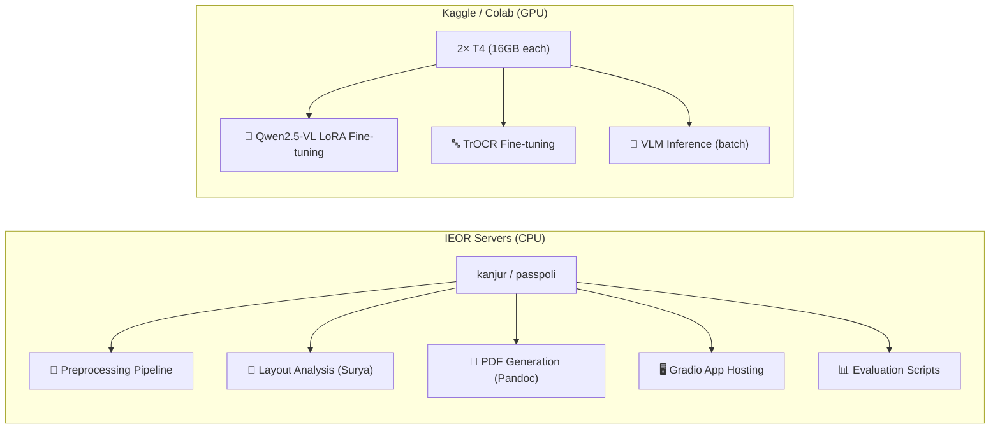
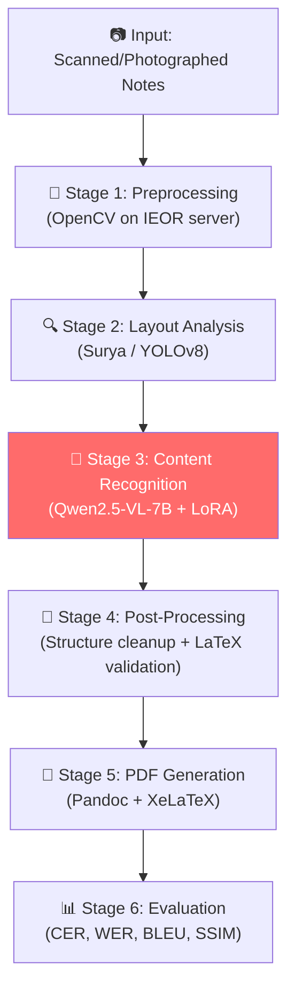

# Handwritten Lecture Notes → Digital PDF: Updated Project Roadmap

> **Team:** 2 people · **Timeline:** 4 weeks · **GPU:** Kaggle (2×T4) + Colab Pro · **Domain:** Any notes (testing with IE643 Deep Learning)

---

## 1. IITB IEOR Server — What You Have & How to Use It

### 1.1 Available Servers

| Server | CPU | Cores | RAM | GPU | Best Use |
|--------|-----|-------|-----|-----|----------|
| **kanjur** | Xeon Gold 6530 @ 4.0GHz | 32 | 256 GB | ❌ None | Heavy preprocessing, batch PDF generation, data annotation |
| **passpoli** | Threadripper PRO 5975WX | 32 | 128 GB | ❌ None | Preprocessing, inference with quantized models (CPU) |
| **tirandaz** | Xeon E5506 @ 2.13GHz | 32 | 128 GB | ❌ None | Light tasks, data storage |
| **kopri** | Xeon E5-2650 v4 | 12 | 64 GB | ❌ None | Light tasks |

> [!WARNING]
> **No GPUs on IEOR servers.** These are CPU-only machines. All model training MUST happen on Kaggle/Colab. The IEOR servers are excellent for preprocessing, data pipeline work, PDF generation, and running the final Gradio app.

### 1.2 How to Connect

**From inside IITB campus (or via VPN):**
```bash
# Direct SSH to kanjur (recommended — most powerful)
ssh <your_ldap>@<kanjur_ip>

# Or to passpoli
ssh <your_ldap>@<passpoli_ip>
```

**From outside campus:**
```bash
# Option 1: Use IITB VPN first, then SSH normally

# Option 2: SSH via gateway (jump host)
ssh <your_ldap>@login.ieor.iitb.ac.in
# Then from the gateway:
ssh kanjur

# Option 3: Direct jump (one command)
ssh -J <your_ldap>@login.ieor.iitb.ac.in <your_ldap>@<kanjur_ip>
```

> [!TIP]
> **Ask your TA/sysadmin** for the exact IP addresses of `kanjur` and `passpoli`. They have Anaconda pre-installed, so you can create conda environments directly.

### 1.3 Where What Runs



---

## 2. GPU Strategy

### 2.1 Primary: Kaggle Notebooks (FREE — 2× T4 GPUs)
- **30 hours/week** of GPU time (plenty for this project)
- 2× NVIDIA T4 (16GB VRAM each)
- Perfect for Qwen2.5-VL-7B with 4-bit quantization + LoRA
- Save trained adapters → download → deploy on IEOR server for CPU inference

### 2.2 Backup: Google Colab Pro ($12/month)
- Access to A100 (40/80GB) — faster training
- Use only if Kaggle quota runs out

### 2.3 Training → Deployment Flow

```
┌──────────────────┐     ┌──────────────────┐     ┌──────────────────┐
│   Kaggle (GPU)   │     │   Download to     │     │  IEOR Server     │
│                  │     │   local / IEOR    │     │  (CPU Inference) │
│ Fine-tune with   │────▶│   LoRA adapter    │────▶│  Load base model │
│ LoRA (saves only │     │   (~50-100MB)     │     │  + LoRA adapter  │
│ adapter weights) │     │                   │     │  in 4-bit quant  │
└──────────────────┘     └──────────────────┘     └──────────────────┘
```

> [!IMPORTANT]
> With 4-bit quantization, Qwen2.5-VL-7B needs ~5GB RAM for inference. The kanjur server (256GB RAM) can comfortably run CPU inference — it'll be slower (~30-60s per page) but totally workable for the demo.

---

## 3. Updated System Architecture



**Key simplification for 4 weeks:** Use Qwen2.5-VL as a **unified model** — it handles text recognition, equation recognition, AND structure understanding in one pass. This eliminates the need for 3 separate models.

---

## 4. Compressed 4-Week Plan

### Task Division

| Role | Person | Focus |
|------|--------|-------|
| **Person A (You)** | Pipeline + ML | Preprocessing, VLM fine-tuning, recognition pipeline |
| **Person B** | Data + Output | Dataset creation, PDF generation, Gradio UI, evaluation, report |

---

### Week 1: Foundation (Days 1–7)

#### Person A — Setup & Preprocessing
| Day | Task |
|-----|------|
| 1 | Set up conda env on kanjur, install dependencies, create GitHub repo |
| 2 | Build preprocessing pipeline (grayscale, denoise, binarize, deskew) |
| 3 | Test preprocessing on 20+ real note pages, iterate and fix edge cases |
| 4 | Set up Kaggle notebook, download Qwen2.5-VL-7B, test zero-shot inference |
| 5 | Integrate Surya for layout detection, test on preprocessed images |
| 6–7 | Help Person B with annotation, fix preprocessing issues |

#### Person B — Data Collection & Annotation
| Day | Task |
|-----|------|
| 1 | Scan/photograph 100+ pages of IE643 Deep Learning notes (300 DPI) |
| 2 | Scan 100+ more pages from other courses (math, stats, CS — for diversity) |
| 3 | Use GPT-4o/Gemini API to auto-transcribe all pages into structured Markdown |
| 4–5 | Manually review and correct 50+ transcriptions (ground truth) |
| 6 | Split dataset: 150 train / 30 val / 30 test |
| 7 | Prepare JSONL training data for Qwen2.5-VL fine-tuning |

---

### Week 2: Model Training (Days 8–14)

#### Person A — Fine-tuning
| Day | Task |
|-----|------|
| 8 | Prepare Kaggle fine-tuning notebook (Unsloth + LoRA setup) |
| 9–10 | Run Qwen2.5-VL LoRA fine-tuning (3–5 epochs, ~8–12 hours on T4) |
| 11 | Evaluate on validation set, compute CER/WER |
| 12 | If results poor: adjust hyperparams, add data augmentation, retrain |
| 13 | (Optional) Fine-tune TrOCR on IAM as baseline comparison model |
| 14 | Download LoRA adapter, test inference on IEOR server (CPU) |

#### Person B — PDF Pipeline & Layout
| Day | Task |
|-----|------|
| 8 | Install Pandoc + TexLive on kanjur, test basic Markdown→PDF |
| 9 | Design custom LaTeX template (professional fonts, colors, layout) |
| 10 | Build PDF generation pipeline: Markdown → Pandoc → XeLaTeX → PDF |
| 11 | Handle edge cases: equations, diagrams (as images), tables |
| 12 | Test PDF generation on 10+ manually created Markdown files |
| 13 | Start building evaluation metric scripts (CER, WER, BLEU) |
| 14 | Annotate 20 additional test pages for layout evaluation |

---

### Week 3: Integration & Interface (Days 15–21)

#### Person A — End-to-End Pipeline
| Day | Task |
|-----|------|
| 15 | Build `pipeline.py`: image → preprocess → layout → recognize → markdown |
| 16 | Integrate with Person B's PDF generator: markdown → PDF |
| 17 | Test full pipeline on 20 unseen pages, debug failures |
| 18 | Optimize inference speed on IEOR server (batching, caching) |
| 19 | Handle multi-page documents (reading order, page merging) |
| 20–21 | Fix bugs, handle edge cases, optimize |

#### Person B — Gradio UI & Evaluation
| Day | Task |
|-----|------|
| 15 | Build Gradio web interface (upload → preview → download PDF) |
| 16 | Add options: skew correction, contrast enhancement, font selection |
| 17 | Display side-by-side: original image | recognized Markdown | output PDF |
| 18 | Add metrics display in UI (CER, WER, confidence scores) |
| 19 | Run full evaluation on test set (30 pages) |
| 20 | Generate qualitative comparison images for report |
| 21 | Conduct mini user study (ask 3–5 classmates to rate output) |

---

### Week 4: Polish & Submission (Days 22–28)

#### Both — Joint Tasks
| Day | Task |
|-----|------|
| 22 | Final pipeline testing on diverse notes (math, CS, stats) |
| 23 | Fix remaining bugs, improve error handling |
| 24 | Package models: save LoRA adapter, config files, model cards |
| 25 | Write comprehensive README with setup instructions |
| 26 | Write stage-wise project report (sections split between A & B) |
| 27 | Record demo video, prepare presentation |
| 28 | Final submission: code + models + report + demo |

---

## 5. Environment Setup (Run These First)

### 5.1 On IEOR Server (kanjur)

```bash
# SSH into kanjur
ssh <your_ldap>@<kanjur_ip>

# Create project directory
mkdir -p ~/Project643 && cd ~/Project643

# Create conda environment
conda create -n handnotes python=3.11 -y
conda activate handnotes

# Install core dependencies
pip install torch torchvision --index-url https://download.pytorch.org/whl/cpu
pip install transformers accelerate peft bitsandbytes
pip install opencv-python-headless Pillow scikit-image
pip install gradio
pip install jiwer nltk sacrebleu
pip install surya-ocr
pip install markdown latex2mathml

# Install system tools for PDF generation
# (You may need to ask sysadmin to install these system-wide)
# sudo apt install pandoc texlive-xetex texlive-fonts-extra
# OR use conda:
conda install -c conda-forge pandoc
conda install -c conda-forge texlive-core texlive-xetex

# Verify
python -c "import torch; print(f'PyTorch: {torch.__version__}')"
python -c "import transformers; print(f'Transformers: {transformers.__version__}')"
pandoc --version
```

### 5.2 On Kaggle (GPU Training Notebook)

```python
# First cell of your Kaggle notebook
!pip install -q unsloth transformers peft accelerate bitsandbytes
!pip install -q qwen-vl-utils jiwer

# Verify GPU
import torch
print(f"GPU: {torch.cuda.get_device_name(0)}")
print(f"VRAM: {torch.cuda.get_device_properties(0).total_mem / 1e9:.1f} GB")
```

---

## 6. Key Implementation Details

### 6.1 Qwen2.5-VL Fine-tuning (Kaggle Notebook)

```python
from unsloth import FastVisionModel
from trl import SFTTrainer, SFTConfig
import json

# Load model in 4-bit quantization
model, tokenizer = FastVisionModel.from_pretrained(
    "unsloth/Qwen2.5-VL-7B-Instruct-bnb-4bit",
    load_in_4bit=True,
)

# Add LoRA adapters
model = FastVisionModel.get_peft_model(
    model,
    r=16,               # LoRA rank
    lora_alpha=32,
    target_modules=["q_proj", "k_proj", "v_proj", "o_proj",
                     "gate_proj", "up_proj", "down_proj"],
    lora_dropout=0.05,
)

# Training config
training_args = SFTConfig(
    output_dir="./qwen_handnotes_lora",
    num_train_epochs=3,
    per_device_train_batch_size=1,
    gradient_accumulation_steps=4,
    learning_rate=2e-5,
    lr_scheduler_type="cosine",
    warmup_ratio=0.1,
    fp16=True,
    logging_steps=10,
    save_strategy="epoch",
    evaluation_strategy="epoch",
    remove_unused_columns=False,
)

# Train
trainer = SFTTrainer(
    model=model,
    args=training_args,
    train_dataset=train_dataset,
    eval_dataset=val_dataset,
    tokenizer=tokenizer,
)
trainer.train()

# Save LoRA adapter (small, ~50-100MB)
model.save_pretrained("./qwen_handnotes_lora")
# Download this folder and transfer to IEOR server
```

### 6.2 Training Data Format

```json
{
  "messages": [
    {
      "role": "user",
      "content": [
        {"type": "image", "image": "page_042.jpg"},
        {"type": "text", "text": "Convert this handwritten lecture note page to clean structured Markdown. Use LaTeX ($$...$$) for equations. Mark headings with #, use bullet points and numbering as in the original. Preserve all content accurately."}
      ]
    },
    {
      "role": "assistant", 
      "content": "# Backpropagation\n\n## Chain Rule\n\nThe gradient of the loss with respect to weight $w$ is computed as:\n\n$$\\frac{\\partial L}{\\partial w} = \\frac{\\partial L}{\\partial y} \\cdot \\frac{\\partial y}{\\partial w}$$\n\n### Steps:\n1. Forward pass: compute activations layer by layer\n2. Compute loss at output\n3. Backward pass: propagate gradients\n\n> **Key insight:** Each layer only needs the gradient from the layer above it."
    }
  ]
}
```

### 6.3 CPU Inference on IEOR Server

```python
from transformers import Qwen2_5_VLForConditionalGeneration, AutoProcessor
from peft import PeftModel
import torch

# Load base model in 4-bit on CPU (uses ~5GB RAM — kanjur has 256GB)
base_model = Qwen2_5_VLForConditionalGeneration.from_pretrained(
    "Qwen/Qwen2.5-VL-7B-Instruct",
    torch_dtype=torch.float32,
    device_map="cpu",
    load_in_4bit=True,  # needs bitsandbytes CPU support
)

# Load your fine-tuned LoRA adapter
model = PeftModel.from_pretrained(base_model, "./qwen_handnotes_lora")
processor = AutoProcessor.from_pretrained("Qwen/Qwen2.5-VL-7B-Instruct")

# Inference (~30-60 seconds per page on kanjur)
def recognize_page(image_path):
    image = Image.open(image_path)
    messages = [
        {"role": "user", "content": [
            {"type": "image", "image": image},
            {"type": "text", "text": "Convert this handwritten note to structured Markdown with LaTeX equations."}
        ]}
    ]
    inputs = processor(messages, return_tensors="pt")
    output = model.generate(**inputs, max_new_tokens=2048)
    return processor.decode(output[0], skip_special_tokens=True)
```

> [!TIP]
> **Faster alternative for demo day:** If CPU inference is too slow, run the Gradio app on kanjur but point inference to a Kaggle/Colab notebook running as an API endpoint (using `ngrok` or `gradio.live`).

---

## 7. Datasets — What to Get & Where

| Dataset | Size | Get From | What For |
|---------|------|----------|----------|
| **Your IE643 notes** | 100–200 pages | Scan yourself | Primary test data |
| **Diverse notes** | 100+ pages | Classmates, other courses | Domain generalization |
| **IAM Handwriting** | 13K text lines | [HuggingFace](https://huggingface.co/datasets/Teklia/IAM-line) | TrOCR baseline training |
| **CROHME 2019** | ~10K equations | [Kaggle](https://www.kaggle.com/datasets) | Equation recognition eval |
| **HME100K** | 100K equations | Kaggle | Extra equation data |

### Bootstrap Annotation Script
```python
import google.generativeai as genai  # or openai

def auto_transcribe(image_path):
    """Use Gemini/GPT-4o to generate initial transcription."""
    model = genai.GenerativeModel("gemini-2.0-flash")
    img = genai.upload_file(image_path)
    response = model.generate_content([
        img,
        "Convert this handwritten page to structured Markdown. "
        "Use LaTeX for math ($$...$$). Preserve headings, bullets, numbering."
    ])
    return response.text

# Auto-transcribe all pages, then manually review/correct
```

---

## 8. Evaluation Plan

### 8.1 Metrics to Report

| Metric | Formula | Target | Tool |
|--------|---------|--------|------|
| **CER** | edit_distance(pred, ref) / len(ref) | < 8% | `jiwer` |
| **WER** | word_edit_distance / word_count | < 15% | `jiwer` |
| **BLEU-4** | n-gram precision with brevity penalty | > 0.65 | `sacrebleu` |
| **ExpRate** | exact_match(pred_eq, ref_eq) / total_eq | > 50% | Custom |
| **SSIM** | structural similarity of output PDF render | > 0.75 | `skimage` |
| **Throughput** | pages per minute | > 1 pg/min | Timing |

### 8.2 Qualitative Evaluation
Create a comparison grid for the report:

```
┌────────────────┬────────────────┬────────────────┐
│  Original Scan │ Recognized MD  │  Output PDF    │
│  (handwritten) │ (intermediate) │  (final)       │
│                │                │                │
│  [Image 1]     │  ```markdown   │  [PDF render]  │
│                │  # Heading     │                │
│                │  - bullet      │                │
│                │  $$E=mc^2$$    │                │
│                │  ```           │                │
└────────────────┴────────────────┴────────────────┘
```

---

## 9. Gradio Interface Design

```python
import gradio as gr

with gr.Blocks(theme=gr.themes.Soft(), title="HandNotes → PDF") as demo:
    gr.Markdown("# 📝 HandNotes → PDF Converter")
    gr.Markdown("Upload handwritten lecture notes and get a clean, formatted PDF.")
    
    with gr.Row():
        with gr.Column(scale=1):
            input_images = gr.Files(
                label="📤 Upload Note Pages",
                file_types=["image"],
                file_count="multiple"
            )
            with gr.Accordion("⚙️ Options", open=False):
                skew_correct = gr.Checkbox(label="Auto skew correction", value=True)
                enhance = gr.Checkbox(label="Contrast enhancement", value=True)
                gen_toc = gr.Checkbox(label="Generate table of contents", value=False)
            
            convert_btn = gr.Button("🚀 Convert to PDF", variant="primary", size="lg")
        
        with gr.Column(scale=2):
            with gr.Tabs():
                with gr.Tab("📄 Preview"):
                    markdown_out = gr.Markdown(label="Recognized Content")
                with gr.Tab("📊 Metrics"):
                    metrics_out = gr.JSON(label="Quality Metrics")
                with gr.Tab("🖼️ Side-by-Side"):
                    gallery = gr.Gallery(label="Original vs Output")
            
            pdf_download = gr.File(label="📥 Download PDF")
    
    convert_btn.click(
        fn=process_pipeline,
        inputs=[input_images, skew_correct, enhance, gen_toc],
        outputs=[markdown_out, pdf_download, metrics_out, gallery]
    )

demo.launch(server_name="0.0.0.0", server_port=7860, share=True)
```

> [!TIP]
> Run `demo.launch(share=True)` on kanjur to get a public URL your TA can access during the demo, even from outside campus.

---

## 10. What to Cut (Scope Management for 4 Weeks)

| Feature | Status | Reason |
|---------|--------|--------|
| ✅ Preprocessing pipeline | **Keep** | Essential, straightforward |
| ✅ Qwen2.5-VL fine-tuning | **Keep** | Core deliverable |
| ✅ PDF generation (Pandoc) | **Keep** | Essential output |
| ✅ Gradio interface | **Keep** | Required deliverable |
| ✅ CER/WER/BLEU metrics | **Keep** | Required deliverable |
| ⚠️ TrOCR fine-tuning | **Nice-to-have** | Do only if Week 2 goes smoothly (baseline comparison) |
| ⚠️ YOLOv8 layout training | **Nice-to-have** | Use Surya instead (pre-trained, no training needed) |
| ❌ LayoutLMv3 training | **Cut** | Too complex for 4 weeks |
| ❌ Custom diagram recognition | **Cut** | Just crop diagrams as images |
| ❌ Table structure recognition | **Cut** | Handle as text for now |

---

## 11. Repository Structure (Simplified)

```
Project643/
├── README.md
├── requirements.txt
│
├── data/
│   ├── raw_scans/           # Original scanned images
│   ├── processed/           # After preprocessing
│   ├── annotations/         # Ground truth Markdown files
│   └── splits.json          # Train/val/test split mapping
│
├── src/
│   ├── preprocess.py        # OpenCV preprocessing pipeline
│   ├── layout.py            # Surya-based layout detection
│   ├── recognize.py         # Qwen2.5-VL inference wrapper
│   ├── postprocess.py       # Markdown cleanup & validation
│   ├── pdf_gen.py           # Pandoc + LaTeX PDF generation
│   ├── evaluate.py          # CER, WER, BLEU, SSIM metrics
│   └── pipeline.py          # End-to-end orchestrator
│
├── notebooks/
│   ├── 01_data_exploration.ipynb
│   ├── 02_qwen_finetuning.ipynb   # Run on Kaggle
│   ├── 03_trocr_baseline.ipynb    # Run on Kaggle (optional)
│   └── 04_evaluation.ipynb
│
├── app/
│   └── gradio_app.py        # Web interface
│
├── models/
│   └── qwen_lora_adapter/   # Downloaded from Kaggle
│
├── templates/
│   └── lecture_notes.tex     # Custom LaTeX template
│
└── reports/
    └── project_report.pdf
```

---

## 12. Risk Mitigation (Updated)

| Risk | Mitigation |
|------|------------|
| **IEOR server has no GPU** | Train on Kaggle (30hr/week free GPU), inference via CPU with 4-bit quant |
| **CPU inference too slow for demo** | Pre-process test pages in advance; or use `gradio.live` tunnel to Colab GPU |
| **Qwen fine-tuning doesn't converge** | Fall back to zero-shot Qwen2.5-VL (already very good) + prompt engineering |
| **Pandoc/TexLive not installed on kanjur** | Install via conda (`conda install pandoc texlive-core`) — no root needed |
| **4 weeks too tight** | Scope cuts already built in; TrOCR baseline and YOLOv8 are optional |
| **Low annotation quality** | Bootstrap with Gemini/GPT-4o, manually verify only critical test set |

---

## 13. Remaining Open Questions

> [!IMPORTANT]
> Just two things to confirm:

1. **Can you install packages on kanjur?** Do you have `conda` access, or do you need to ask the sysadmin? (This determines setup time on Day 1.)
2. **Do you have a Gemini or OpenAI API key?** We need this for bootstrapping annotations (auto-transcribing your notes). A free Gemini API key from Google AI Studio works fine.
