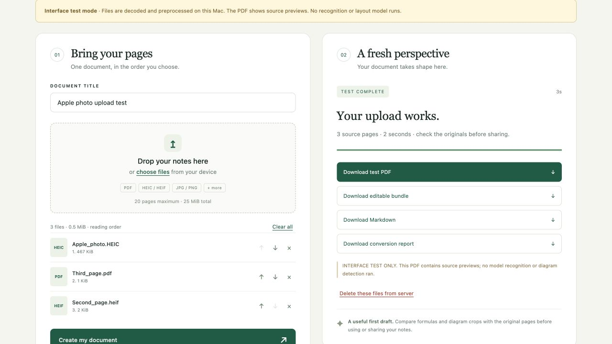
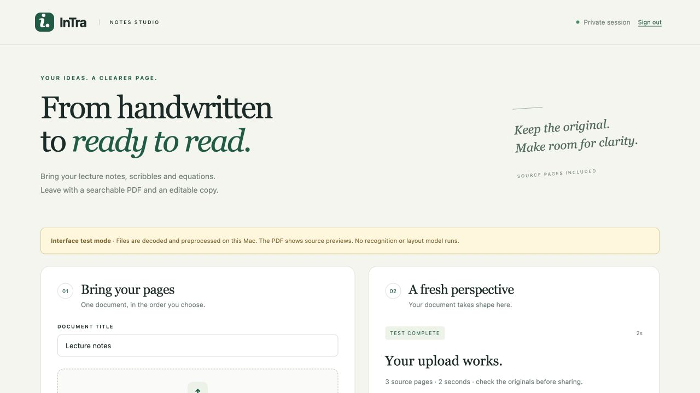

# Mac interface validation — 2026-10-25

## Result and scope

The refreshed interface was exercised in the actual in-app browser on this Mac. Real HEIC/HEIF input decoding, file ordering, preprocessing, downloads, sign-in and idle restart recovery were tested. **No CUDA, Surya or Qwen inference ran on Mac.** Local mode uses an explicitly labelled source-preview PDF, with an “INTERFACE TEST ONLY - NO OCR OR LAYOUT MODEL” stamp on every page. This provides input/UI/deployment evidence, not recognition or reconstruction scores.

## Browser evidence

- Signed in without putting the access key in download URLs or browser storage.
- Selected an actual HEIC-encoded notebook photo, a separately generated HEIF image and a one-page PDF.
- Reordered PDF ahead of HEIF in the browser. Saved page map confirmed `001.heic → 002.pdf → 003.heif`.
- Converted all three through real image extraction and the existing NotesPreprocessor. The three-page interface-test PDF was produced in about two seconds on that run.
- Clicked Download PDF. The downloaded bytes exactly matched the generated artifact; all three PDF pages were inspected programmatically for the test-only stamp.
- SHA-256 of that local test PDF: `12bf75bd9fc5c5c21960a421a53f47de155662af31461355a6918b5277a3e2a2`.
- Restarted the owned service and refreshed: the signed-in browser recovered the completed result and working download links. The final security revision stores the signing secret separately from the shared login key; its persistence and forgery rejection were additionally tested in the backend suite. Moving from the old signing scheme invalidates old cookies once.
- Actual unauthenticated API, health and download requests returned401. Repeat start reused the existing supervisor.
- Browser test exposed and fixed a multipart parser limit that rejected ordinary 0.5MiB uploads. A regression uses an800KiB multipart part.
- Restart test exposed a TIME_WAIT port-probe issue; the owned launcher now uses SO_REUSEADDR and waits for shutdown before returning.

The initial browser conversion used Pillow12.3.0; the dependency audit then identified37 known advisories in that release. Pillow was upgraded to13.0.0, and the entire final25-test interface suite (including real HEIC/HEIF/orientation tests) and13 renderer tests passed again. No new browser conversion is claimed after that upgrade.

## HTTPS verification and permission limit

Downloaded official cloudflared Darwin arm64 version2026.10.3 into ignored test storage. The managed launcher established an outbound HTTP/2 Quick Tunnel, configured the exact HTTPS origin and launched Waitress. The HTTPS page loaded and access-key sign-in succeeded in the browser. Cookie flags/host/origin/CSRF behavior are covered by the backend tests.

**The public HTTPS file-upload test was not completed.** Automatic approval review rejected sending the project-derived photo through a third party without specific payload authorization. A standalone synthetic HEIC was generated instead, but the browser upload permission was declined. No alternate/indirect upload was attempted. A later page-observation approval timed out; that was not an unsafe-content finding. Project-derived input was tested locally; do not claim it was uploaded via Cloudflare.

A temporary authenticated Mac preview may be running; use `manage.py status` for its current URL. URLs change with tunnel restart. This is interface-test mode, not GPU reconstruction. The GPU deployment awaits the confirmed retrained adapter directory and an actual GPU acceptance run.

## Final automated checks

- **25 interface tests pass**: real HEIC/HEIF decoding/order, JPEG EXIF and HEIF container orientation without double rotation, transparency to white, forged-extension and oversized-image rejection; corrupt/encrypted/over20-page PDFs; TeX/file/resource filtering; exact layout schema and process ownership; isolated recognition lifecycle; login/auth/CSRF/origin/host/cookie flags; separate per-browser jobs; separate private operator/signing credentials; cookie-forgery rejection; multipart/decoded limits, busy/deletion behavior, retained jobs/expiry, and interrupted-job recovery.
- **13 renderer regression tests pass.** Upload rendering disables raw HTML/TeX and shell escape. Full Pandoc/XeLaTeX execution was unavailable on Mac and is pending GPU verification.
- JavaScript syntax check passed with bundled Node.
- All **100 saved prediction Markdown files** pass the tightened validator (compatibility check only; no rescoring/inference).
- `pip-audit -r 06_interface/requirements.txt`: **no known vulnerabilities reported**,10 resolved packages, after the Pillow upgrade. This is an as-of audit of the UI dependency set, not an audit of the entire GPU/model/native-library stack or a security certification.
- `git diff --check` passed.

Raw final check evidence: [interface tests](interface-tests.txt), [renderer tests](renderer-tests.txt), [dependency audit](dependency-audit.json).

## Runtime and remaining GPU work

Mac: Python3.12.14, Flask3.1.3, Werkzeug3.1.9, Waitress3.0.2, pillow-heif1.8.1, Pillow13.0.0, PyMuPDF2.0; isolated under ignored `out/interface-py312`. A preliminary Python3.9 environment was used only during setup, then replaced for the final tests.

Run the documented GPU test only when training is idle and the new adapter path is known: real upload → tested Surya → new adapter → PDF → visually check crops/formulas → verify VRAM release → repeat. Do not substitute an older adapter or the Mac preview backend. User will confirm the model location later. See [deployment runbook](../../docs/INTERFACE_DEPLOYMENT.md).
